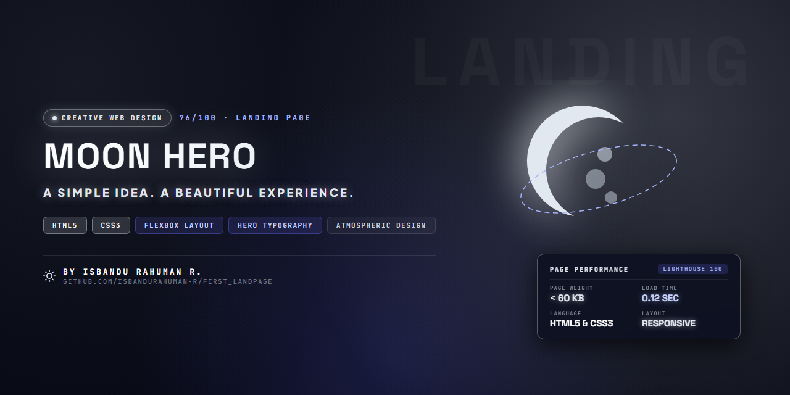

<p align="center">
  
</p>

# ◈ Moon Landing Page

## ◆ About the Project
Moon Landing Page is a responsive promotional webpage developed using HTML and CSS as part of the CodSoft Web Development Internship. The project demonstrates core front-end styling principles including CSS Flexbox layouts, typography hierarchy, and asset composition.

## ❖ Key Features
- ▪ Central hero section with heading typography, descriptive body text, and call-to-action buttons.
- ▫ Responsive layout adapting smoothly to desktop, tablet, and mobile viewport sizes.
- ▴ Clean lunar aesthetic featuring custom CSS styling and imagery.

## ⬢ Technologies Used
- HTML5
- CSS3

## § Requirements
- Modern web browser

## ▲ Installation & Execution
```bash
# Open index.html directly or serve locally
python -m http.server 8000
```
Open `http://localhost:8000` in your web browser.

## ※ Developer
Developer: ISBANDU RAHUMAN R  
GitHub: https://github.com/ISBANDURAHUMAN-R
